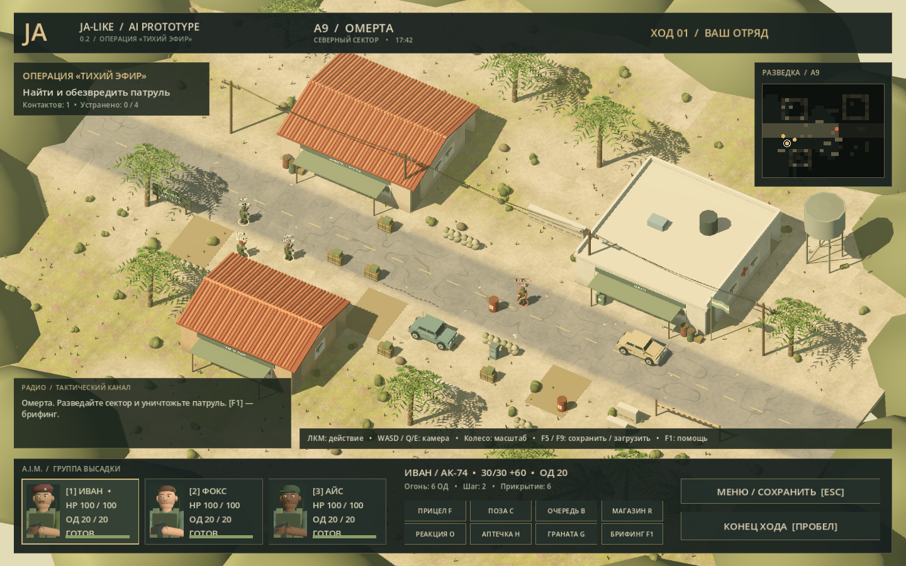
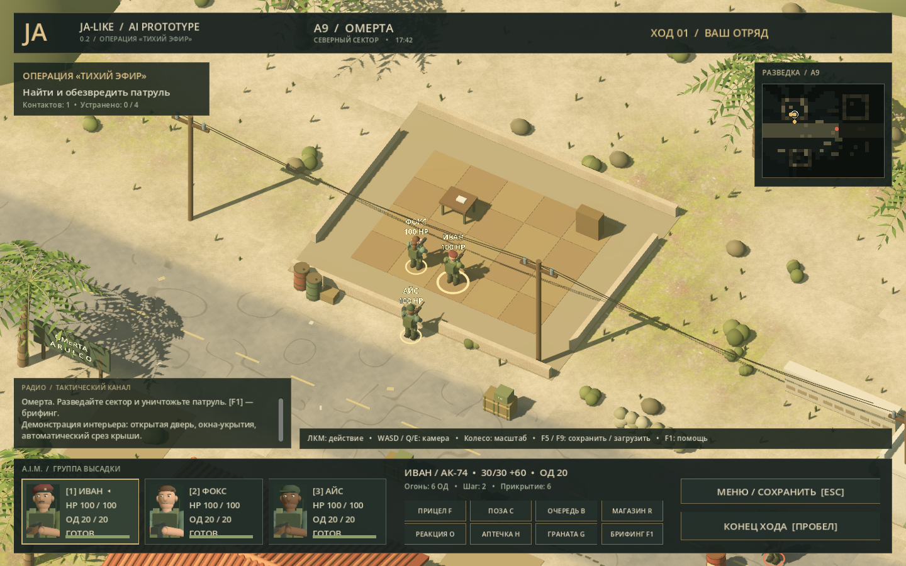

# JA-like AI Prototype

Самостоятельная пошаговая тактика в духе Jagged Alliance 2: пыльный городок, трое наёмников, укрытия, разведка и короткая перестрелка в полноценной 3D-сцене. **Godot 4.7.2, Windows x64.** Это демонстрационный прототип, а не порт JA2 и не законченный ремейк.

[Скачать Windows-сборку](https://github.com/Kpoji4er/ja-like-ai-prototype/releases/latest) · [Исходники](https://github.com/Kpoji4er/ja-like-ai-prototype) · [Изменения v0.2.0](docs/CHANGELOG.md)



**Операция «Тихий эфир».** Патруль перекрыл дорогу в Омерте. Разведайте сектор и устраните четырёх противников. Иван, Фокс и Айс начинают с 20 ОД каждый. Победа — все противники выведены из боя; поражение — потерян весь отряд.

**Версия 0.2.0, 15.10.2026:** добавлены магазины и перезарядка, очереди, ответный огонь, аптечки, гранаты, обнаружение противников, сохранения, доступные интерьеры, двери и взрывные бочки. Улучшены бойцы, машины, растительность и поверхности. `DEMO.cmd` самостоятельно разыгрывает настоящий бой по тем же правилам.



## Запуск

Скачайте ZIP из **Releases**, распакуйте целиком и запустите **START.cmd**. Движок включён в архив; оригинальная JA2, интернет, Python и редактор Godot для игры не нужны. Для автоматического показа запустите **DEMO.cmd** — после завершения демонстрации окно закроется.

Основной режим — Vulkan / Forward+. При проблемах с видеодрайвером используйте **START-OPENGL.cmd** или PowerShell:

```powershell
.\launch.ps1 --rendering-method gl_compatibility
```

Оба режима проверены на RTX 4080. OpenGL использует более простое освещение. Другие компьютеры пока не проверялись. Папка сборки должна быть доступна для записи: в ней создаются кэш, журналы и сохранения.

Для **исходников**: выполните `powershell -NoProfile -ExecutionPolicy Bypass -File scripts/setup-godot.ps1`, затем `START.cmd`. Скрипт скачает закреплённую версию движка внутрь проекта. Можно также открыть `game/project.godot` в Godot 4.7.2.

## Управление

| Действие | Управление / цена |
| --- | --- |
| Выбрать наёмника | ЛКМ по бойцу или карточке; 1 / 2 / 3; Tab — следующий живой |
| Перемещение | ЛКМ по земле; 2 ОД за клетку, маршрут показан точками |
| Одиночный выстрел | ЛКМ по видимому врагу; 6 ОД, 1 патрон |
| Прицел / очередь | F: 8 ОД, +18% точности; B: 9 ОД, 3 патрона, −15% |
| Перезарядка | R; 5 ОД, запас патронов ограничен |
| Присесть / встать | C; 2 ОД, поза влияет на точность |
| Ответный огонь | O; резерв 6 ОД, один выстрел при движении врага в обзоре |
| Лечение | H, затем ЛКМ по себе или соседнему бойцу; 6 ОД и аптечка |
| Граната | G, затем ЛКМ по земле; 8 ОД, дальность 7 клеток, радиус 2,4 |
| Дверь | Подойти вплотную и нажать ЛКМ по двери; 2 ОД |
| Топливная бочка | ЛКМ по красной бочке; 6 ОД и патрон, взрыв радиусом 3 клетки |
| Конец хода | Пробел; затем ОД живых наёмников восстанавливаются |
| Отмена режима действия | ПКМ |
| Камера | WASD, Q/E, колесо; Home — исходный вид; ЛКМ по мини-карте — перейти |
| Тактическая сетка | V; зелёные клетки оставляют 6 ОД на выстрел, жёлтые — без запаса на выстрел |
| Крыши | T; при входе в дом крыша и верх стен скрываются автоматически |
| Сохранить / загрузить | F5 / F9; один слот `saves/quicksave.json` |
| Брифинг / меню | F1 / Esc |
| Полный экран / фото | F11 / F2; F12 — снимок в `build/screenshot.png` |

Гранаты и бочки опасны для своих. Фокс восстанавливает 50 HP, остальные — 35. Резерв ответного огня отменяется повторным нажатием O с возвратом ОД; неиспользованный резерв заканчивается с ходом противника. Режим не гарантирует попадание.

## Что реализовано

Один сектор **32×26 клеток**, три наёмника и четыре противника. Перемещение обходит стены, мебель, укрытия и живых бойцов. Низкие укрытия защищают с соответствующей стороны. Окна пропускают огонь, но не движение. Закрытые двери блокируют путь и обзор; ИИ умеет открывать их при преследовании.

Обзор отряда ограничен 12 клетками и стенами. Незамеченные враги скрыты; мини-карта хранит разведанную область. Противники реагируют на выстрелы, ищут позиции, стреляют и используют ответный огонь. Бочки уничтожаются выстрелом или гранатой и освобождают проход.

Сохранение содержит здоровье, ОД, боезапас, снаряжение, позиции, двери, бочки, разведку, камеру и состояние генератора случайных чисел. Повреждённый файл отклоняется до изменения текущего боя. Сохраняться можно в свой ход между действиями; после поражения можно загрузить прежнее состояние.

Визуал: процедурная геометрия, PBR-текстуры грунта и штукатурки, направленные тени, объёмное затенение в Forward+, движущаяся листва, флаг, пылевые частицы, трассеры и 3D-портреты. Звуки синтезируются в игре. Источники текстур и лицензии перечислены в [ASSETS.md](docs/ASSETS.md).

## Границы прототипа

Нет кампании, стратегической карты, диалогов, полноценного инвентаря, скелетной анимации и разрушения стен. Разрушаются только специальные топливные бочки. Геометрия остаётся стилизованной и процедурной. Формулы боя упрощены и не повторяют JA2 точно. Скрываются противники и неразведанные участки мини-карты; само окружение в 3D остаётся видимым. Баланс демонстрационный: автоматический отряд выигрывает стартовый сценарий достаточно легко.

## Файлы и локальные данные

- `game/main.gd` — бой, навигация, камера и интерфейс.
- `game/tactics.gd` — снаряжение, разведка, ответный огонь и ИИ.
- `game/save_system.gd`, `explosives.gd` — сохранения и взрывные объекты.
- `game/world.gd`, `buildings.gd`, `scene_details.gd` — городок и интерьеры.
- `game/characters.gd`, `vehicles.gd`, `vegetation.gd` — процедурные модели.
- `game/effects.gd`, `tactical_overlay.gd`, `minimap.gd` — эффекты и тактические подсказки.
- `game/assets/` — включённые в сборку CC0-текстуры.
- `tools/` — загруженный движок; `.runtime/` — локальные TEMP, TMP, APPDATA, LOCALAPPDATA.
- `game/.godot/` — кэш Godot; `build/` — журналы, тестовые данные, кадры и видео; `saves/` — сохранения.

Все явно создаваемые загрузки, временные файлы, кэши и результаты работы размещаются внутри папки проекта. Скрипт запуска меняет переменные среды только своего процесса и дочернего движка, не системные настройки Windows. Сохранения, служебные папки и пользовательские данные не попадают в Git или релиз.

## Проверки

```powershell
.\launch.ps1 --headless -- --test
.\launch.ps1 --headless -- --soak
.\launch.ps1 -- --ui-test
.\launch.ps1 -- --gallery
.\launch.ps1 --disable-vsync -- --perf
```

Основной набор проверяет навигацию, линию огня, укрытия, ОД, стрельбу, двери, преследование ИИ, снаряжение, реакции, взрывы, сохранения, повреждённые файлы, победу, поражение и перезапуск сцены. `--soak` выполняет восемь автоматических прохождений с разными seed и проверяет инварианты состояния между ходами. Это автоматические прогоны, а не пользовательское тестирование баланса.

`--gallery` сохраняет несколько реальных кадров в `build/`; часть кадров использует специально расставленную демонстрационную сцену. `--perf` измеряет неподвижный стартовый сектор после прогрева на текущем ПК; результаты не являются гарантией производительности других систем. Подробности проверки релиза — [QA-v0.2.0.md](docs/QA-v0.2.0.md).

## Источники

[JA2 Stracciatella](https://github.com/ja2-stracciatella/ja2-stracciatella): `src/game/Tactical/Points.h` изучен как справочник оригинальной системы ОД. Он не включён в код игры, публичный репозиторий или релиз и не компилируется. Механика написана отдельно.

[Godot](https://godotengine.org/license/) — MIT; уведомления включены в `docs/`. [ambientCG](docs/ASSETS.md) — CC0. Прототип не является официальным продуктом правообладателей Jagged Alliance.

## Журнал работы

Все метки времени — **Москва (UTC+3), 14–15 октября 2026 года**. Учитывается прошедшее календарное время, включая ожидание инструментов. Проценты не используются.

Первые интервалы восстановлены по времени создания файлов и контрольным снимкам: это **приблизительная разбивка между контрольными точками**, а не точное измерение чистого времени каждой задачи. Подготовительные обсуждения и поиск до 02:13:58 не измерялись. С 02:31:03 время этапов фиксируется непосредственно во время работы.

| Начало (МСК) | Окончание (МСК) | Затрачено | Задача и результат |
| --- | --- | --- | --- |
| 02:13:58 | 02:19:16 | ≈ 5 мин 18 с | Загрузка Godot, справочник ОД Stracciatella, создание проекта, локальные служебные папки и скрипт запуска. |
| 02:19:16 | 02:22:07 | ≈ 2 мин 51 с | Процедурная Омерта: дома, крыши, дорога, пальмы, машины, укрытия, модели бойцов. |
| 02:22:07 | 02:26:17 | ≈ 4 мин 10 с | Камера, интерфейс, мини-карта, навигация, ОД, стрельба, ИИ, исход операции и первые тесты. |
| 02:26:17 | 02:28:26 | ≈ 2 мин 09 с | Первый запуск, исправление пересвета, переход на Forward+, объёмные листья, фиксация камеры для снимка. Скриншот показан пользователю. |
| 02:28:26 | 02:31:03 | ≈ 2 мин 37 с | Проверка полного хода боя, анимация шага, фактура штукатурки. Исправлена тестовая сцена: перед проверкой победы восстановлено здоровье погибшего тестового бойца. Все проверки прошли. |
| 14.10 02:31:03 | 14.10 02:32:41 | 1 мин 38 с | Оформление README и учёта времени. Описание игры, журнал с метками МСК и скрипт записи последующих этапов добавлены. |
| 14.10 02:32:41 | 14.10 02:35:35 | 2 мин 54 с | Доводка интерфейса и проверка запуска. Добавлены 3D-портреты и полосы здоровья, улучшены подсказки. Пройден полный тест боя и реального перезапуска сцены. Финальный кадр отрисован через Vulkan без ошибок. |
| 14.10 02:35:35 | 14.10 02:37:29 | 1 мин 53 с | Подготовка переносимой сборки и итоговой документации. Переносимая папка build/JA2-Arulco-3D собрана с движком и исходниками, проверена отдельным запуском. Добавлены лицензии и результаты тестов; исправлен размер полос здоровья, финальный скриншот проверен. |
| 14.10 02:43:00 | 14.10 02:45:55 | 2 мин 55 с | Публикация публичного GitHub-репозитория и релиза v0.1.0. Публичный репозиторий Kpoji4er/ja-like-ai-prototype и релиз v0.1.0 опубликованы. ZIP Windows x64 (83,5 MiB) и SHA-256 загружены; распакованная сборка прошла полный тест боя и перезапуска. Публичный доступ подтверждён запросом без авторизации. |
| 15.10 01:51:16 | 15.10 01:59:17 | 8 мин 01 с | Часовая доработка: аудит, боевые системы и визуальное направление. Добавлены обнаружение и память разведки, реакция, боезапас/перезарядка, очереди, аптечки, гранаты с дружественным огнём, сохранение и брифинг. Новые проверки снаряжения, видимости, реакций, гранат и сохранений прошли; исправлена обработка JSON-координат. |
| 15.10 01:59:17 | 15.10 02:10:22 | 11 мин 04 с | Визуальная доработка: поверхности, бойцы, окружение и обратная связь боя. Добавлены CC0-текстуры, новые модели бойцов, детали городка и эффекты боя. Сделаны доступные интерьеры, двери за 2 ОД, окна-укрытия и автоматический срез крыш; тесты дверей и сохранений прошли. |
| 15.10 02:10:23 | 15.10 02:20:31 | 10 мин 08 с | Управление, тактические подсказки, игровые прогоны и исправления. Добавлены сетка доступных ОД, полная работа дверей у ИИ, взрывные бочки, улучшенные пальмы и машины, автоматическая демонстрация. Пройдены 8 боёв с разными seed; записан реальный 38-секундный бой. Vulkan и OpenGL запускаются без ошибок. |
| 15.10 02:20:31 | 15.10 02:32:59 | 12 мин 28 с | Финальная проверка, документация и переносимая сборка v0.2.0. Пройдены основные тесты, 8 боевых прогонов (17 ходов ИИ), проверка настоящего UI-ввода и чистой распаковки. Исправлены брифинг и возврат ОД прикрытия; архив 92,4 MiB запускается без кэша проекта. README, управление, источники ассетов, QA и видео обновлены. |
<!-- WORKLOG_ROWS_END -->

**Текущий этап:** нет активного таймера; завершённые этапы приведены выше.

Для продолжения журнала: `scripts/log-task.ps1 -Action Start -Task 'Описание этапа'`, затем `scripts/log-task.ps1 -Action Finish -Result 'Полученный результат'`. Состояние таймера хранится только в `.runtime/`, завершённые записи — в этой таблице.
